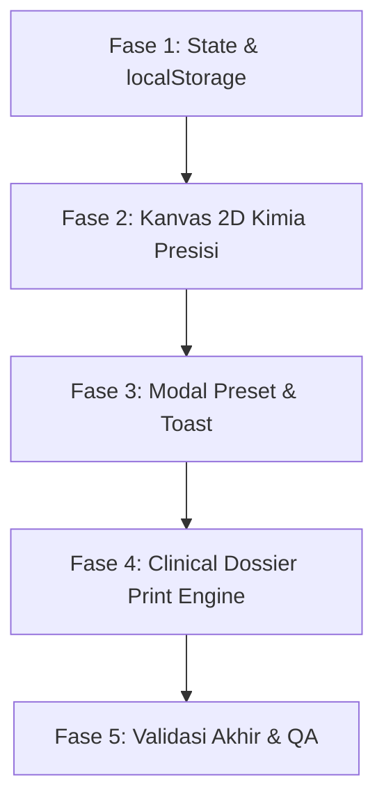

# 📋 TASK BREAKDOWN — GenePharm Explorer (V2 Implementation)

Dokumen ini memuat peta jalan (*roadmap*) dan pembagian tugas bertahap (*step-by-step task breakdown*) untuk menyempurnakan platform **GenePharm Explorer** berdasarkan dokumen `implementation-plan-genepharm-v2.md`.

---

## 📌 Status Pelacakan Proyek (Project Tracker)

- [x] **Fase 0: Setup & Initial Push** *(Selesai)*
  - [x] Simpan kode terbaru ke `index.html`
  - [x] Dokumentasi dasar pada `README.md`
  - [x] Inisialisasi Git & hubungkan ke GitHub `wooharam-jason/GenePharm`
  - [x] Push commit perdana ke branch `main`
- [x] **Fase 1: State Management & Data Persistence (`localStorage`)** *(Selesai)*
  - [x] **Tugas 1.1: Sinkronisasi Otomatis `localStorage`**
  - [x] **Tugas 1.2: Tombol Reset ke Standar Klinis**
  - [x] **Tugas 1.3: Ekspor & Impor Database (JSON Backup)**

---

## 🚀 Fase 1: State Management & Data Persistence (`localStorage`)
*Tujuan: Memastikan data penyakit kustom yang ditambahkan oleh pengguna tidak hilang saat halaman di-refresh, serta mendukung pencadangan data.*

- [x] **Tugas 1.1: Sinkronisasi Otomatis `localStorage`** *(Selesai)*
  - Buat konstanta key storage: `genepharm_master_db_v2`.
  - Buat fungsi `loadDatabase()` yang mengecek `localStorage` terlebih dahulu; jika kosong, inisialisasi dengan `masterDiseases` bawaan.
  - Buat fungsi `saveDatabase()` yang menyimpan array data ke `localStorage` setiap kali ada penambahan atau perubahan data.
- [x] **Tugas 1.2: Tombol Reset ke Standar Klinis** *(Selesai)*
  - Sediakan opsi tombol pada UI/header untuk mengembalikan database ke 7 penyakit standar acuan CPIC awal.
  - Tambahkan dialog konfirmasi pengamanan sebelum reset dijalankan.
- [x] **Tugas 1.3: Ekspor & Impor Database (JSON Backup)** *(Selesai)*
  - Implementasikan tombol "Ekspor Database (JSON)" untuk mengunduh seluruh data dalam format `.json`.
  - Implementasikan file picker "Impor Database (JSON)" dengan validasi skema data agar pengguna dapat memulihkan database dari file JSON.

---

## 🧪 Fase 2: Peningkatan Engine Kanvas Struktur Kimia 2D Skeletal
*Tujuan: Memberikan visualisasi rumus rangka 2D spesifik khas farmakope untuk seluruh 7 obat bawaan tanpa mengandalkan representasi generik.*

- [ ] **Tugas 2.1: Implementasi Struktur 2D Olaparib**
  - Gambar cincin bisiklik *phthalazinone* dengan substituen fluorobenzyl dan piperazine-cyclopropanecarbonyl.
  - Beri pewarnaan atom hetero: Nitrogen ($N$ cyan), Oksigen ($O$ merah), Fluorin ($F$ hijau).
- [ ] **Tugas 2.2: Implementasi Struktur 2D Ivacaftor (Kalydeco)**
  - Gambar kerangka *quinoline-carboxamide* tersubstitusi *tert-butylphenol*.
  - Tampilkan ikatan amida dan gugus hidroksil dengan posisi atom yang tepat.
- [ ] **Tugas 2.3: Implementasi Struktur 2D Simvastatin**
  - Gambar sistem cincin heksahidronaftalena (*decalin core*) dengan rantai samping ester *dimethylbutyrate* dan cincin lakton terhidrolisis.
- [ ] **Tugas 2.4: Implementasi Struktur 2D Abacavir**
  - Gambar cincin purina aminopurin dengan cincin siklopentenil dan substituen siklopropilamino.

---

## 🎨 Fase 3: Peningkatan UI/UX & Modal Input Kustom
*Tujuan: Mempermudah pengguna mengisi data klinis baru secara cepat dan akurat.*

- [ ] **Tugas 3.1: Template Input Cepat (*Preset Templates*) pada Modal**
  - Sediakan 3 tombol template pada modal penambahan penyakit untuk memuat data otomatis:
    - *Depresi Mayor / SSRI* (`CYP2D6` / `CYP2C19` - Escitalopram)
    - *Sindrom Stevens-Johnson* (`HLA-B 5801` - Allopurinol)
    - *Toksisitas Mielosupresi* (`UGT1A1` - Irinotecan)
- [ ] **Tugas 3.2: Sistem Notifikasi Toast Interaktif**
  - Buat komponen visual *Toast notification* (sukses, peringatan, info) yang muncul saat:
    - Penyakit baru berhasil disimpan.
    - Database diimpor/diekspor.
    - Database direset ke default.
- [ ] **Tugas 3.3: Shortcut Keyboard & Indikator Pencarian Cerdas**
  - Tombol `ESC` untuk mereset kata kunci pencarian.
  - Tombol silang (*clear button*) pada kolom pencarian saat input terisi.
  - *Debounce* input 120ms untuk memastikan transisi filter kartu berjalan mulus.

---

## 📄 Fase 4: Penguatan Format Laporan (*Clinical Dossier Print Engine*)
*Tujuan: Menjamin hasil cetak A4 memiliki standar rekam medis dan publikasi penelitian yang rapi.*

- [ ] **Tugas 4.1: Styling Cetak `@media print` A4 Formal**
  - Sembunyikan seluruh tombol navigasi, search bar, dan modal saat mode print aktif.
  - Pastikan grafik respons dosis Chart.js dan kanvas struktur kimia 2D tercetak tajam tanpa terpotong (*page-break-inside: avoid*).
  - Tampilkan kop resmi dossier dengan tanggal real-time dan tanda tangan validasi penelitian.

---

## 🔍 Fase 5: Pengujian, Validasi Klinis & QA
*Tujuan: Memastikan tidak ada error JavaScript dan visual tetap presisi di berbagai ukuran layar.*

- [ ] **Tugas 5.1: Uji Bebas Asteris Alel**
  - Verifikasi seluruh teks alel (seperti `CYP2C19 Alel 2`, `CYP2C9 Alel 1/2`) tidak mengandung asteris mentah yang dapat merusak parsing formatting.
- [ ] **Tugas 5.2: Uji Responsivitas Mobile, Tablet, dan Desktop**
  - Uji tata letak pada resolusi smartphone (< 640px), tablet (< 1024px), dan layar lebar desktop (> 1280px).
- [ ] **Tugas 5.3: Validasi Sintaks JavaScript**
  - Pastikan 0 error pada konsol browser (`SyntaxError`, `TypeError`, atau `ReferenceError`).

---

## 📈 Alur Eksekusi Bertahap

